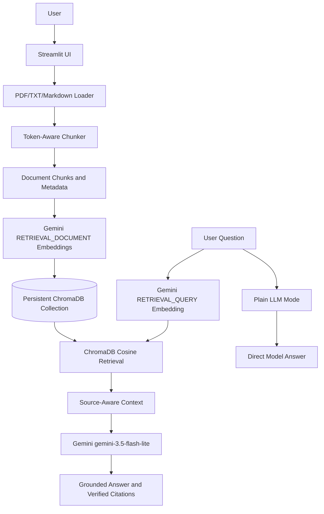
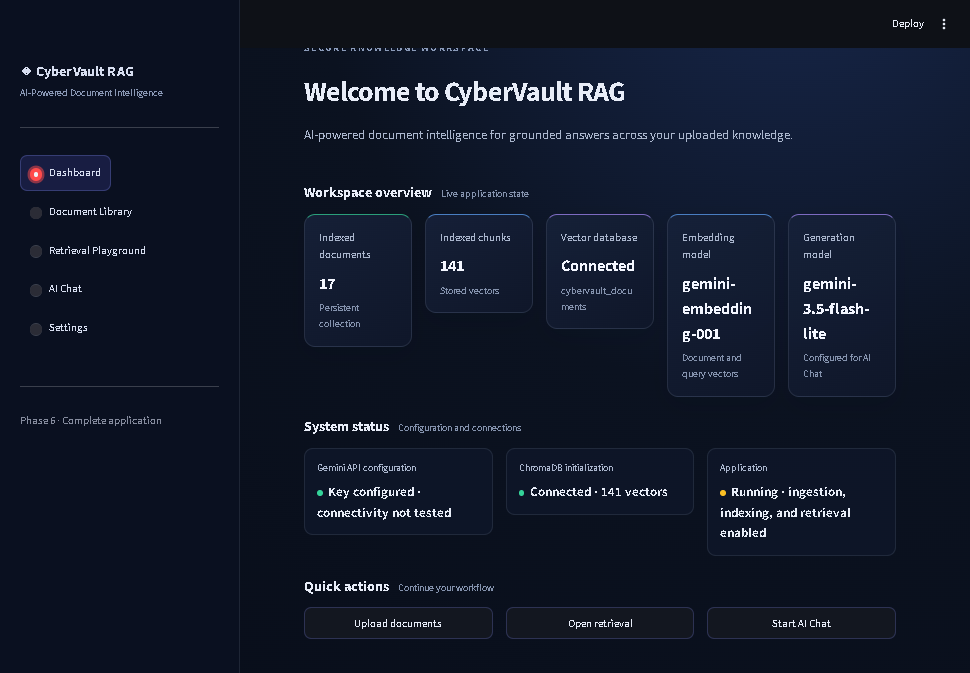
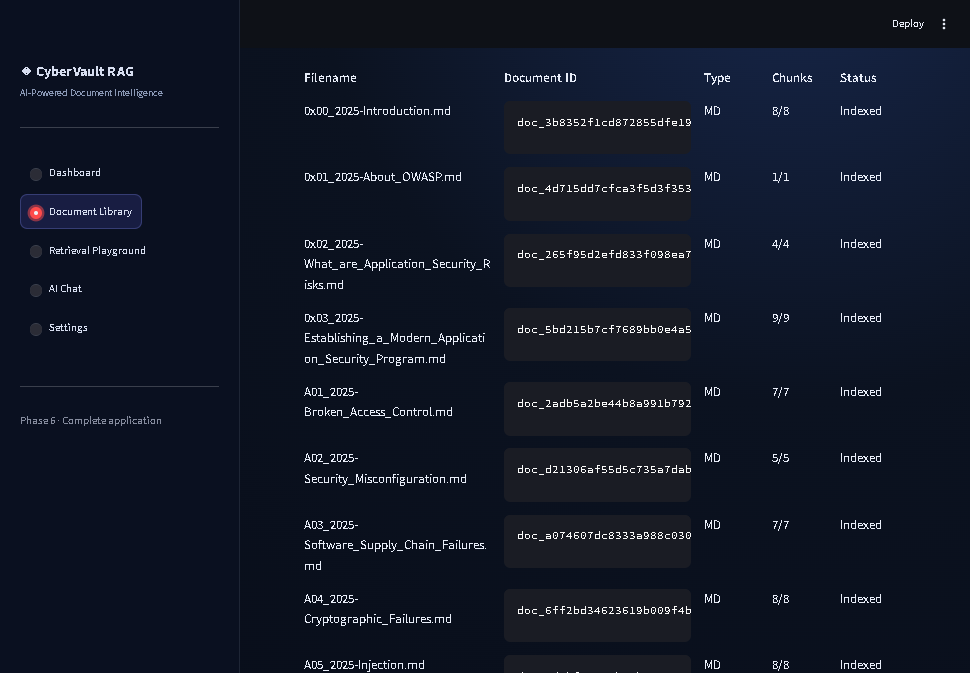
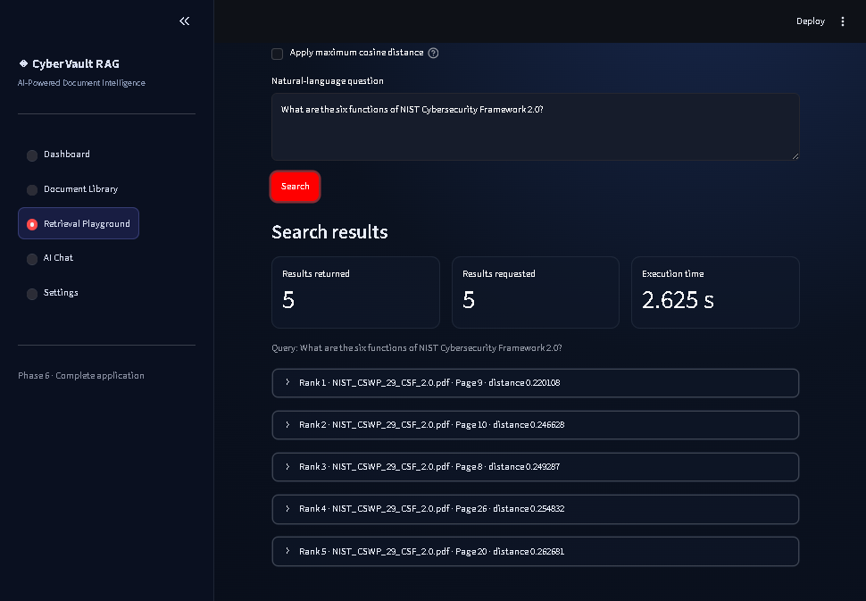
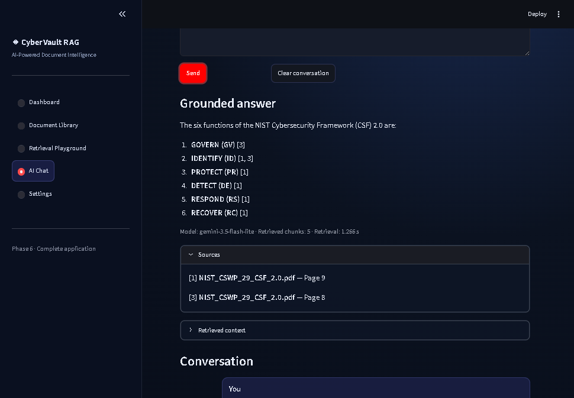
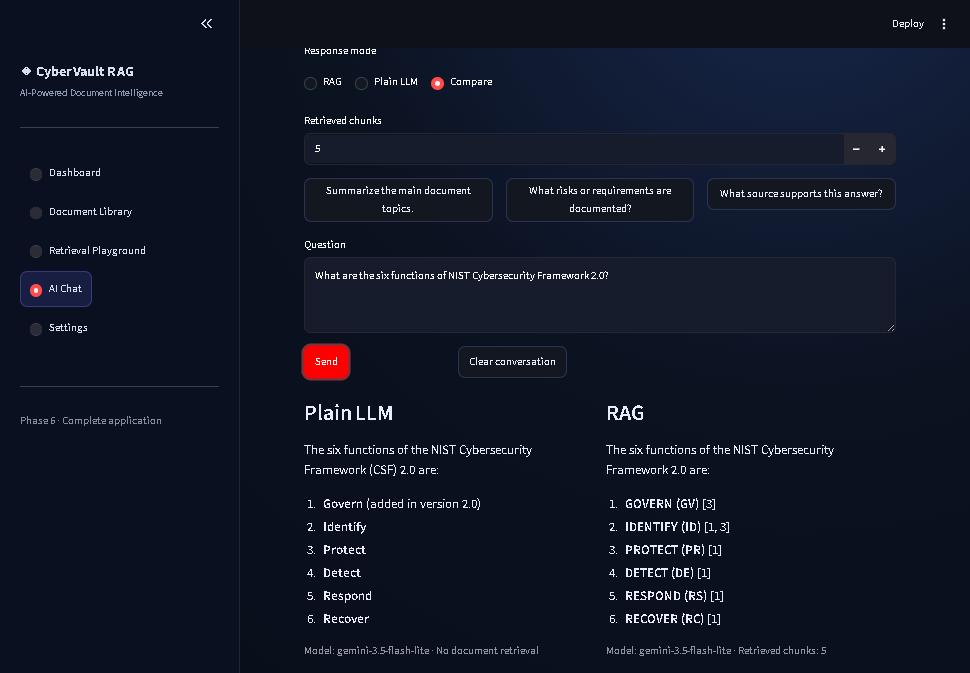
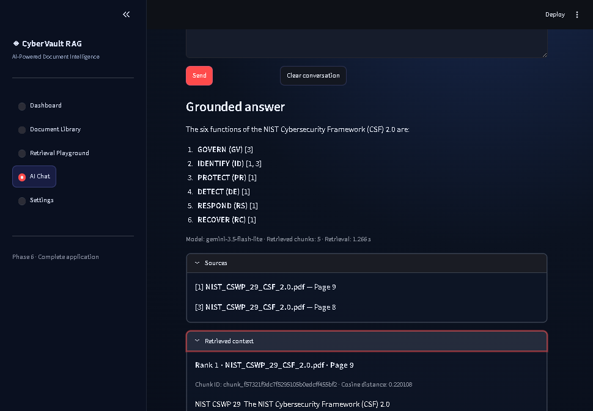

# CyberVault RAG

**AI-Powered Document Intelligence**

CyberVault RAG is a modular Streamlit application for searching private PDF,
TXT, and Markdown documents with Gemini embeddings and grounded Gemini
generation. It preserves source metadata, maintains a persistent ChromaDB
collection, and clearly separates direct model answers from document-grounded
RAG answers.

## Problem statement

General-purpose language models can provide useful explanations, but they do
not have reliable knowledge of private, recently changed, or organization-specific
documents. Without external context, a model may invent an answer or cite a
source that was never supplied.

## Solution

CyberVault RAG combines:

1. Source-aware document ingestion and chunking.
2. Gemini document embeddings.
3. Persistent ChromaDB cosine search.
4. Gemini query embeddings and ranked retrieval.
5. Context-attributed generation.
6. Source citation validation.
7. Plain LLM and RAG comparison.

## Features

- PDF, UTF-8 TXT, and UTF-8 Markdown ingestion
- Page-aware PDF extraction
- Approximate token-aware chunking with overlap
- Stable document and chunk identifiers
- Gemini `gemini-embedding-001` document and query embeddings
- Persistent local ChromaDB storage
- Duplicate prevention and scoped document deletion
- Semantic retrieval with cosine distance
- Configurable top-K and optional distance filtering
- Gemini `gemini-3.5-flash-lite` grounded generation
- Validated source citations
- Missing-context handling
- Plain LLM, RAG, and Compare modes
- Session-based chat history
- Polished Dashboard, Document Library, Retrieval Playground, AI Chat, and Settings

## Technology stack

- Python 3.11+
- Streamlit
- Google GenAI SDK
- ChromaDB
- PyPDF
- python-dotenv
- pytest

## System architecture



## RAG workflow

1. Upload a supported document in Document Library.
2. Extract text and generate source-aware chunks.
3. Create Gemini document embeddings and persist them in ChromaDB.
4. Enter a question in Retrieval Playground or AI Chat.
5. Embed the question with `RETRIEVAL_QUERY`.
6. Retrieve the nearest chunks using cosine distance.
7. Build numbered, source-attributed context.
8. Generate an answer using only that context.
9. Validate `[n]` and grouped `[n, m]` citations against retrieved chunks.
10. Display the answer, source list, and retrieved context.

Cosine distance is the raw ChromaDB distance. Lower values indicate closer
matches; they are not percentages or confidence scores.

An answer with no verified source citations is replaced with an explicit
insufficient-context response. This prevents an uncited model response from
being presented as a grounded RAG answer.

## Project structure

```text
CyberVault-RAG/
├── app.py
├── config.py
├── requirements.txt
├── .env.example
├── .gitignore
├── README.md
├── core/
│   ├── embedding_service.py
│   ├── retrieval_engine.py
│   ├── generation_service.py
│   └── rag_pipeline.py
├── ingestion/
│   ├── document_loader.py
│   ├── text_extractor.py
│   ├── chunker.py
│   ├── inspection.py
│   ├── processor.py
│   └── indexing_pipeline.py
├── vectorstore/
│   └── chroma_store.py
├── evaluation/
│   ├── retrieval_evaluator.py
│   ├── cybersecurity_queries.py
│   └── test_queries.py
├── ui/
│   └── components.py
├── tests/
├── data/
├── assets/
└── docs/
```

## Windows installation

```powershell
cd C:\Users\Pranay\Desktop\CyberVault-VK
py -3.11 -m venv .venv
.\.venv\Scripts\Activate.ps1
python -m pip install --upgrade pip
python -m pip install -r requirements.txt
if (-not (Test-Path .env)) { Copy-Item .env.example .env }
```

## Environment configuration

Edit `.env` and replace the placeholder:

```dotenv
GEMINI_API_KEY=your_gemini_api_key_here
GEMINI_EMBEDDING_MODEL=gemini-embedding-001
GEMINI_GENERATION_MODEL=gemini-3.5-flash-lite
CHROMA_PERSIST_DIRECTORY=data/chroma
CHROMA_COLLECTION_NAME=cybervault_documents
CHUNK_SIZE=500
CHUNK_OVERLAP=100
RETRIEVAL_TOP_K=5
RETRIEVAL_MAX_TOP_K=20
RETRIEVAL_MIN_DISTANCE=
EMBEDDING_BATCH_SIZE=32
EMBEDDING_DIMENSION=3072
GENERATION_TEMPERATURE=0.2
GENERATION_MAX_OUTPUT_TOKENS=1024
RAG_CONTEXT_LIMIT=12000
```

Do not commit `.env` or paste a real key into source code or documentation.

## Run

```powershell
streamlit run app.py
```

Open the URL printed by Streamlit, typically `http://localhost:8501`.

## Usage

1. Open **Document Library** and upload PDF, TXT, or Markdown files.
2. Process the documents and inspect generated chunks.
3. Select **Index processed documents** when a Gemini key is configured.
4. Use **Retrieval Playground** for source-ranked semantic search.
5. Use **AI Chat** in RAG, Plain LLM, or Compare mode.
6. Review configuration in **Settings**.

## Dashboard and storage status

All displayed document counts and vector values come from session state or the
configured ChromaDB collection. The application does not fabricate indexing or
database readiness values.

## Verified live dataset

The local dataset contains the official NIST CSF 2.0 PDF and 16 OWASP Top
10:2025 English Markdown documents. The original source files are preserved
under `data/documents/`; provenance and reuse terms are in
[docs/dataset_sources.md](docs/dataset_sources.md).

Verified indexing statistics:

- 17 documents processed; 32 NIST PDF pages extracted
- 141 chunks generated with a configured 500-token target and 100-token overlap
- 141 real `gemini-embedding-001` document embeddings, each 3072 dimensions
- 141 vectors persisted in the `cybervault_documents` ChromaDB collection at
  `data/chroma`; the index remained available after reopening the client
- All documents are fully indexed; no dataset duplicates were present before
  ingestion

### Local data and publication handling

The persistent ChromaDB files in `data/chroma/` are local runtime data and are
excluded from Git. The source corpus in `data/documents/` is also intentionally
excluded: OWASP Top 10 content is CC BY-SA 4.0 and requires attribution and
ShareAlike compliance, while the NIST PDF may contain separately credited
third-party material. Consult [docs/dataset_sources.md](docs/dataset_sources.md)
and the original publisher sources before redistributing any corpus files.
The source URLs and filenames are documented there for local setup.

## Retrieval evaluation

Eight live semantic queries were evaluated at **K=5** using manually
annotated relevant chunk IDs from the actual indexed documents. The measured
results were **Hit Rate@5 1.000, Precision@5 0.350, Recall@5 1.000, and MRR
0.938**. Other chunks in the same file were not automatically considered
relevant. One query intentionally asks for four GOVERN categories; the NIST
source actually lists six, and the annotation records that correction.

See [docs/retrieval_evaluation.md](docs/retrieval_evaluation.md) for the query
set, relevant chunk IDs, metric definitions, and individual results.

## RAG versus Plain LLM

Three identical questions were sent to Plain LLM and RAG using live
`gemini-3.5-flash-lite` requests. Both modes answered the common NIST functions
question correctly. On an OWASP-specific question, Plain LLM referred to the
older 2021 category while RAG returned the 2025 description with citations. On
the exact Broken Access Control incidence rates, Plain LLM returned incorrect
figures (94% and 3.81%); RAG retrieved and cited the indexed source values
(20.15% maximum and 3.74% average). This is one observed comparison, not a
claim that RAG is always better.

Full observed responses and source checks are in
[docs/rag_vs_plain_llm.md](docs/rag_vs_plain_llm.md).

## Citation verification

Live RAG citations were checked against the exact retrieved chunk IDs and
source text. Citation numbers map to the context sections supplied to
Gemini; unsupported numeric references are removed. PDF page metadata is
preserved, and Markdown references are displayed as unpaginated
document-level sources. The validator checks citation-to-context mapping;
the cited claims in the reported live examples were also manually reviewed.
See [docs/phase8_final_report.md](docs/phase8_final_report.md) and the detailed
[Phase 8 validation record](docs/phase8_validation_report.md).

## Screenshots

These genuine screenshots were captured from the running Streamlit application
with the persistent local index. They use consistent 970×673 pixel dimensions
and do not show API credentials.

### Dashboard



### Indexed document library



### Live retrieval results



### Grounded RAG response and citations



### Plain LLM and RAG comparison



### Expanded source context



## Testing

```powershell
python -m pytest -q
python -m compileall -q app.py config.py core ingestion vectorstore evaluation ui tests
```

The complete suite reports **102 passing tests**. The dedicated Streamlit
AppTest file reports **10 passing tests**, covering page rendering, chat mode
selection, conversation clearing, verified source display, and retrieved
context expansion.

Verification evidence is separated by type:

- **Automated unit tests:** SDK calls are mocked; tests do not call Gemini.
- **Local ChromaDB tests:** use isolated temporary collections for persistence
  and retrieval checks.
- **Live Gemini verification:** real model/API requests and the live AI Chat
  smoke test are recorded in the Phase 8 reports.
- **Live RAG evaluation:** eight real query embeddings were evaluated against
  the persistent corpus; results and exact relevance annotations are in
  [docs/retrieval_evaluation.md](docs/retrieval_evaluation.md).

## Live Gemini verification

Live requests were made with the configured models: `gemini-embedding-001`
for `RETRIEVAL_DOCUMENT` and `RETRIEVAL_QUERY`, and
`gemini-3.5-flash-lite` for generation. The API key was detected but is never
printed or included in this documentation. Real RAG answers, citations,
unanswerable-question behavior, and retrieval metrics are recorded in
[docs/phase8_final_report.md](docs/phase8_final_report.md).

## Limitations

- The eight-query retrieval evaluation is a small, manually chunk-annotated
  sample and should not be generalized to all cybersecurity queries.
- The optional cosine-distance threshold is unset. Out-of-scope queries can
  still retrieve nearest neighbors; the RAG pipeline now abstains when no
  citation is verified, but retrieval itself is not a semantic relevance
  classifier.
- Citation validation checks that numeric references map to supplied chunks;
  it does not independently prove every generated claim. The reported live
  examples were manually checked against their cited chunk text.
- Markdown sources are unpaginated; no page numbers are inferred for them.
- Gemini quota and transient service errors can delay live operations; batch
  indexing is resumable and successful vectors are preserved.
- The application does not perform OCR.
- Chat history is session-local.
- There is no persistent conversation database.
- Context is truncated at complete source sections only.
- Citations are verified against retrieved chunk references, not independently
  fact-checked after generation.
- No answer generation occurs in Retrieval Playground.

## Future improvements

- OCR for scanned PDFs
- Hybrid lexical and vector search
- Streaming generation
- Persistent chat history
- Role-based access
- Production secret management
- Automated live evaluation
- Additional document formats

## Repository publication

Repository name: `CyberVault-RAG`

Description:

`AI-powered cybersecurity document intelligence using Gemini embeddings, ChromaDB, semantic retrieval and grounded RAG generation.`

Topics:

`artificial-intelligence`, `rag`, `cybersecurity`, `python`, `streamlit`,
`gemini`, `chromadb`, `vector-database`, `semantic-search`

Git is unavailable in this environment, so repository status and staging could
not be inspected. After installing Git, review the staged file list carefully;
the `.gitignore` excludes local credentials, the ChromaDB database, and the
local source corpus. Do not commit or push without explicit approval.

```powershell
git init
git add .
git status
git diff --cached --stat
git commit -m "Initial release: CyberVault RAG"
git branch -M main
git remote add origin https://github.com/<username>/CyberVault-RAG.git
git push -u origin main
```
